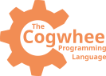

Cogwheel is a fast modern type-safe null-safe embeddable interpreted multiparadigm strongly-typed strictly-typed **general purpose programming language**.
This language was designed to be used for scripting, modding and developing high level applications
while still being relatively fast and flexible.

> [!WARNING]
> This project is in very early development stage. It might be very buggy and not very practical
> to use yet. Also Windows support is completely untested, currently tests are only performed
> on Linux.

# Quick Start

To obtain the programming language you would clone this repository and build the binary file:
```bash
git clone --depth 1 https://github.com/Gearshift-Interactive/Cogwheel
cd Cogwheel
./nob build
bin/cogwheel examples/vector.cog
```

**System Requirements** for building the binary:
- **OS**: Linux (Windows will be available later)
- **Compiler**: GNU C Compiler

## Hello World example

```
alias String = char[];

var print = (str: String) -> {
    mut var i = 0u;
    while (i < #str)
    {
        putChar(str[i]);
        i = i + 1u;
    };
};
var println = (str: String) -> {
    print(str);
    putChar('\n');
};
println("Hello, World!");
```

# Usage

To learn the language you can see some examples, that are included in this repo:
- [Basic vector math](./examples/vector.cog)
- [Pretty printing](./examples/prettyPrint.cog)

Or you can visit the [tutorial](TUTORIAL.md) for detailed and structured list of language features.

